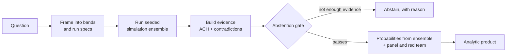

# Proteus

Proteus is a simulation engine for questions about adversaries and the systems they target. It runs many seeded simulations of a synthetic world, turns them into probabilities over ranges of outcomes, and declines to answer when the evidence cannot tell those ranges apart.

The worlds are generated in code. The populations, water networks and power feeders are made up and do not correspond to any real platform or utility. The actors in the contested-system simulator are parameter profiles, and each parameter must name the source it came from. A forecast's terminal output starts with a notice that the world is synthetic.

The repo has two parts: a TypeScript engine with a command line interface (`engine/`), plus a few Python solvers it calls, and a Next.js dashboard that displays what the engine produces (`dashboard/`).

## How it works

### 1. The forecast pipeline

`proteus forecast "<question>"` runs one question from start to finish. The entry point is `engine/src/cli.ts`, which calls `engine/src/forecast.ts`, which calls the orchestrator in `engine/src/pipeline/run-question.ts`. The paths below are relative to `engine/src/`.



1. **Build the evidence base.** `corpus/synthetic.ts` generates a set of dated documents from made-up sources, with contradictions planted on purpose so the contradiction detector can be checked against a known answer. `corpus/as-of.ts` wraps the corpus so nothing published after the `--as-of` date can be retrieved. Without this cutoff a "forecast" could just read the answer.
2. **Frame the question.** `agents/framer.ts` asks a language model to split the outcome range into bands (the hypotheses) and to propose a set of run configurations, each with an adversary risk tolerance and a tendency to escalate. `evidence/partition.ts` checks that the bands cover the whole range with no gaps or overlaps, so the probabilities always sum to 1. If there is no model, or its answer is invalid, the pipeline uses equal-width bands and an evenly spread parameter sweep instead. `--offline` always takes this path.
3. **Run the ensemble.** `pipeline/ensemble.ts` runs every configuration through the simulation kernel (`sim/kernel.ts`), a few at a time. The kernel knows nothing about any domain: a domain plugs in through an adapter with `init`, `step` and `observe` functions. The forecast command uses the influence-ops adapter (`sim/adapters/influence-ops/`, belief spread on a network with bounded-confidence dynamics) or the recruitment adapter (`sim/adapters/recruitment/`). Randomness comes only from the seeded generator in `sim/rng.ts`, so the same seed produces the same event log. A run that fails is recorded instead of stopping the ensemble. Each run is saved by `artifact/store.ts` under a hash of its configuration and a hash of its output.
4. **Turn runs into evidence.** `pipeline/analysis.ts` converts run summaries into claims and an evidence matrix. `evidence/ach.ts` scores the hypotheses with Analysis of Competing Hypotheses, ranking them by how much evidence is against each one. `evidence/contradiction.ts` finds conflicting facts between corpus documents and tries to reconcile them.
5. **Check whether to answer at all.** `evidence/abstention.ts` looks at four signals: whether there is enough evidence that actually separates the hypotheses, whether the top two hypotheses are far enough apart, how many contradictions are unresolved, and what share of claims cite a dated source. If any check fails, the output is an abstention with the reason. This runs before any probability exists, so "we should not answer" cannot turn into a low-confidence answer.
6. **Produce the forecast.** If the gate passes, the probability of each band is the share of ensemble runs that landed in it (`metrics/ensemble.ts`). An adjudication panel (`agents/panel.ts`) then reviews the result with structured analytic techniques such as a key-assumptions check, a devil's advocate and a premortem, and a red team agent (`agents/red-team.ts`) argues against it. The panel affects confidence but never moves the probabilities. If the red team asks for a rerun and the budget allows it (one by default), the pipeline runs the same configurations on new seeds, merges them into the ensemble and checks the gate again. Without a model, the panel and red team are reported as unavailable and the forecast rests on the ensemble alone.
7. **Write the product.** `pipeline/product.ts` builds the final report: a bottom line up front, each band with a likelihood phrase from the ICD 203 scale (`evidence/icd203.ts`), a separate confidence level, indicators to watch, and key assumptions. Before it is returned, the corpus checks one last time that no cited document postdates the cutoff.

### 2. Scoring the forecasts

`pipeline/benchmark.ts` runs batches of questions where the true outcome is known, because a separate "truth" run is drawn in its own seed namespace and never shown to the ensemble. Questions are grouped into arms that test different things, for example evidence that narrows the answer, evidence too weak to separate the bands (the gate should abstain), and a truth drawn from outside the ensemble's assumptions. `metrics/` holds the scoring code: Brier score, the Murphy decomposition, calibration curves and simple baselines. `pipeline/threshold-sweep.ts` replays the gate at other thresholds so the trade-off between abstaining too often and too rarely can be plotted. `metrics/rank-check.ts` is a rank-based check that flags when the observed world does not look like any of the simulated ones.

### 3. Contested-system simulator

`proteus simulate` runs one scenario where one or more actors decide, day by day, whether and how to use access they hold to a system. Paths are relative to `engine/src/` unless shown otherwise.

- **Scenarios** are data. `scenario/packs/` ships three: `regional-grid`, `port-throughput` and `benefits-delivery`. Each defines assets, the dependencies between them, an escalation ladder and candidate defenses. `scenario/spec.ts` holds the Zod schema for them.
- **Actors** are loaded from `engine/data/doctrine-profiles.json` by `actors/library.ts`, which rejects any parameter that has no source attached. `actors/posture.ts` turns those parameters into decision weights with simple linear formulas so they are easy to audit.
- **Each tick**, `sim/adapters/contested-system/decision.ts` scores every move an actor could make as a sum of named terms (gain, exposure, ally reaction, retaliation) and records the whole breakdown, including moves that lost. `oracle.ts` in the same folder estimates the harm of each effect and labels what kind of evidence the estimate rests on.
- **Events** go out on three separate channels: ground truth, telemetry (what a defender could see), and privileged reasoning (the actor's deliberation and any model agent's). `observe/stream.ts` streams them as newline-delimited JSON with `--stream`; the default prints the same events for a terminal.
- **Deep runs** (`--deep`, `scenario/deep-run.ts`) replay the scenario across several worlds, then convene language-model "councils" (`actors/council.ts`) whose seats are the steps of the actor's own decision process, taken from its dossier. A council is advisory: it never overrides the kernel's choice, and where they disagree that disagreement is reported. A final set of judges reviews the worlds together and records dissent.
- **Comparing defenses.** `scenario/compare-arms.ts` replays the same scenario with and without each defense across a shared set of seeds and reports the paired differences, because a single run cannot show whether a defense helped.
- **New scenarios.** `proteus compile` (`scenario/compile.ts`) turns a plain description into a scenario spec using a model. Its output must pass the schema and a set of coherence checks; failures are sent back to the model for repair. With `--retrieve`, `retrieval/web.ts` runs a web search through the Anthropic API and keeps only cited passages that carry a usable date.

### 4. Water consequence model

This is a worked example where the harm numbers come from a real hydraulic solver instead of a formula.

1. `engine/python/consequence/archetypes.py` builds synthetic water networks with WNTR. None of them is a real utility.
2. `solve.py` runs EPANET pressure-dependent simulations for each control component, perturbation type and duration, and reports the change against an unperturbed baseline. Each case is run across several pressure settings and reported as a range, because a single setting can produce misleading numbers. If the settings disagree, the case is marked as not settled.
3. `proteus consequence` calls this solver through a JSON-over-stdin bridge (`engine/python/consequence/bridge.py`, driven by `engine/src/consequence/table.ts`) and caches the result as a table in `engine/.cache/`.
4. `proteus vulnerability` (`engine/src/vulnerability.ts` and `engine/src/pipeline/vulnerability.ts`) runs the cyber-water adapter (`engine/src/sim/adapters/cyber-water/`) over a grid of seeds and adversary postures: one undefended arm, plus one arm per defense (network segmentation, credential rotation, anomaly detection, manual fallback). It ranks the components that cause the most harm, the routes the adversary actually takes, and how much harm each defense prevents per unit of cost. The kernel only reads the cached table, so no solver call happens inside a simulation step and runs stay deterministic.

### 5. Storm restoration lab

A smaller study of the order in which repair crews should fix a damaged power feeder.

- `engine/src/sim/adapters/restoration/` generates synthetic radial feeders and storm damage (`storm.ts`), then plays out a repair schedule for 1 to 4 crews on 15-minute ticks. `rules.ts` holds the repair-order rules being compared, such as most-customers-now, critical-first, nearest-first and upstream-first.
- The best possible order is computed for reference: `horn.ts` implements Horn's exact algorithm for one crew, and `engine/python/restoration/milp.py` solves a time-indexed mixed-integer program with SciPy's HiGHS solver for more crews. `engine/src/restoration/solver.ts` calls it through `bridge.py` and re-checks every returned schedule for feasibility and cost.
- `engine/scripts/restoration-lab.ts` (`npm run restoration:lab`) runs every rule on the same storms and builds the comparison tables described in `docs/RESTORATION-LAB-PREREG.md`.
- `engine/python/eaglei/` checks a county-scale version against real outage records. `fetch.sh` and `fetch_fema.sh` download public EAGLE-I outage data and FEMA disaster declarations. `outages.py`, `storms.py` and `events.py` turn them into per-county outage curves, `county_sim.py` and `fit.py` fit the simulator on the 2018 to 2021 storms, and `held_out.py` scores it on the 2022 to 2025 storms. `unseal.py` refuses to read the held-out years unless the code and fitted files match the hashes recorded in `docs/RESTORATION-ADDENDUM.md`, so the test cannot be quietly re-run after tweaking.

### 6. Dashboard

The Next.js app in `dashboard/` reads JSON files in `dashboard/data/` that the engine writes. It never recomputes a metric itself, so the dashboard and the engine cannot disagree.

| Route                     | What it shows                                                                       |
| ------------------------- | ----------------------------------------------------------------------------------- |
| `/`                       | Overview of the project                                                             |
| `/live`                   | A scenario running live, decision by decision                                       |
| `/calibration`            | Benchmark reliability chart and the gate's operating curve                          |
| `/runs`, `/runs/<hash>`   | Influence-ops runs, tick by tick, with ground truth and telemetry in separate panes |
| `/exposure`               | Output of the water vulnerability sweep                                             |
| `/actors`, `/actors/<id>` | The actor profiles and their sources                                                |

`/live` is the one page that also runs the engine. Its API route (`dashboard/app/api/live/route.ts`) starts the engine CLI in `--stream` mode as a child process and forwards each line to the browser as a server-sent event.

## Project layout

```
engine/
  src/
    cli.ts          command line entry point (forecast, simulate, compile, trace, ...)
    sim/            seeded kernel, RNG, and one adapter per domain
    corpus/         synthetic documents and the as-of cutoff
    evidence/       partitions, ACH, contradictions, abstention gate, ICD 203 terms
    agents/         framer, adjudication panel, red team (model calls)
    pipeline/       forecast orchestration, ensemble, benchmark, dashboard exports
    metrics/        Brier, calibration, baselines, rank check
    actors/         actor profiles, decision weights, councils
    scenario/       scenario specs, packs, compiler, defense comparisons
    llm/            model client interface, Anthropic backend, offline stub
    artifact/       content-addressed run storage
  python/
    consequence/    WNTR/EPANET water network solver
    restoration/    HiGHS repair-scheduling solver
    eaglei/         county outage data pipeline and fit
  data/             actor profiles and per-actor dossiers
  scripts/          one-off studies, snapshots and data builders
  tests/            Vitest suites mirroring src/
dashboard/
  app/              Next.js routes
  components/       charts, run viewer, live view
  lib/              typed loaders for dashboard/data
  data/             JSON published by the engine
  e2e/              Playwright tests
docs/               design notes, pre-registrations and a case study
```

## Tech stack

- TypeScript on Node.js, Commander for the CLI, Zod for schemas, Vitest for tests
- Anthropic Messages API, called directly with `fetch` (optional; everything has an offline path)
- Python 3 with WNTR/EPANET, NumPy, SciPy (HiGHS), pandas and pytest
- Next.js 15, React 19, Tailwind CSS 4, Framer Motion, Playwright

## Running it

### Engine

```bash
cd engine
npm install
npm test
```

One forecast with no model and no network:

```bash
npx tsx src/cli.ts forecast "Where does adoption land by the resolution tick?" --offline
```

To use a model, copy `engine/.env.example` to `engine/.env` and set `ANTHROPIC_API_KEY`. `npm run preflight` checks which keys work. Then:

```bash
npx tsx src/cli.ts forecast "<question>" --measure adoptionRate --bands 4 --runs 16
```

Useful flags: `--domain influence-ops|recruitment`, `--tick` (when the outcome resolves), `--range lo,hi`, `--seed` (same seed, same run), `--as-of YYYY-MM-DD`, `--json`.

Run a contested-system scenario:

```bash
npm run build
node dist/cli.js simulate --presets
node dist/cli.js simulate --pack regional-grid --actors russia --respondents us
```

Add `--defense <kind>` to run with a mitigation, `--stream` for JSON output, or `--deep` for model councils (needs a key and makes paid API calls).

### Python solvers (optional)

There is no requirements file; the solvers expect a virtual environment at `engine/.venv`:

```bash
cd engine
python3 -m venv .venv
.venv/bin/pip install wntr scipy pandas pytest
npm run consequence:build                       # solve the water table into .cache/
npm run vulnerability -- --archetype municipal_pumped
npm run restoration:lab
```

### Dashboard

```bash
cd engine && npm run build      # /live runs engine/dist/cli.js
cd ../dashboard
npm install
npm run dev
```

To regenerate the data the dashboard reads:

```bash
cd engine
npm run snapshot     # benchmark -> dashboard/data/benchmark-snapshot.json
npm run traces       # stored runs -> dashboard/data/run-traces.json
node dist/cli.js manifest
```

Environment variables (names only, see `engine/.env.example`): `ANTHROPIC_API_KEY` (needed only for model calls), plus optional `CLAUDE_CODE_OAUTH_TOKEN`, `OPENAI_API_KEY` and `OPENROUTER_API_KEY`, which only the preflight script probes.

More detail on the design is in `docs/ARCHITECTURE-PROTEUS.md` and `docs/GENERALIZED-ADVERSARY.md`.
