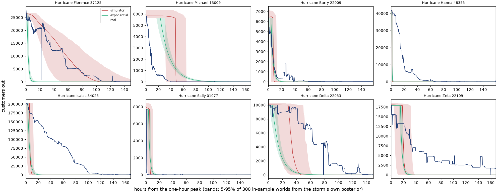

# Real-storm check: Checkpoint 2 results

These are local runs on public data, done on 2026-09-23 at code commit
`51b3dd4`.

- **The rules** are fixed in `RESTORATION-PROTOCOL.md`: frozen at commit
  `2020f07`, with §15 (a schema-read clarification) added at `51b3dd4`.
- **The held-out years (2022–2025)** ran once, from that commit, and gave counts
  only (§3).
- **Evidence class (b):** local runs on the public EAGLE-I and OpenFEMA files.
  No model has been fitted or checked yet; that is Phases 3–4.

## In plain English

- **What this does:** it turns DOE's county power-outage records (customers out
  in nearly every US county, every 15 minutes) into one clean restoration curve
  per county per tropical storm, with a written reason for every curve thrown out. It
  does the full job on the 2018–2021 storms, which the model will learn from.
  For the 2022–2025 storms, which the model will be tested on, it only counts
  how many curves survive. Nobody looks at those curves until the model is
  frozen.
- **What it found:**
  - **Training:** 640 usable county curves from 18 storms, 16 of which have
    at least 5.
  - **Held out:** 553 usable curves from 13 storms, but only **9 storms have at
    least 5**. That is one short of the pre-set bar of 10, as the protocol
    predicted from FEMA's county lists alone. So the headline will be the share
    of county-level looks the check flags, not a count of storms.
  - **The data changed format between the two periods.** The 2018–2021 files
    never record a zero ("nobody out"). The 2022–2025 files do, over a million
    times a year. The rule decided before the freeze handled it mechanically, but
    the change is the biggest risk to a fair test (see "Findings").
- **Why it matters:** this is the first time Proteus's check pipeline touches
  real outcomes; the check itself runs in Phase 4. Every choice was committed
  before the check read any held-out outage value. §3 discloses a 3 MB peek at
  the 2024 file, and §15 followed a header-only read. The code enforces the
  seal, so the results can't be quietly tuned: any change after this point is a
  dated deviation.

## Words used here

- **County-event:** one county's outage curve for one storm, from its peak for
  7 days, or until another outage or the county's next storm begins.
- **Drop:** a curve thrown out, always for a data reason, never for being slow.
  Every drop is logged with its reason.
- **Held-out (sealed):** the 2022–2025 storms. They stay unread until the model
  is fitted and frozen; only counts are allowed out before that.
- **Y:** held-out storms with at least 5 county-events.

## Counts per split

| Step                                       | Training (2018–21) | Held out (2022–25) |
| ------------------------------------------ | -----------------: | -----------------: |
| Declared storm–county pairs                |              2,068 |              1,419 |
| `seen` (2024 file head, §3)                |                  0 |                  4 |
| `no_mcc` (no customer count)               |                 23 |                 13 |
| `not_in_file`                              |                 13 |                  8 |
| `no_event` (never crossed 1% of customers) |                455 |                187 |
| `no_peak`                                  |                  0 |                  0 |
| `left_censored` (already out)              |                 30 |                 17 |
| `not_substantial` (< 1,000 or < 5%)        |                799 |                469 |
| `spike`                                    |    7 (0.9% of 748) |    8 (1.1% of 721) |
| `resurge`                                  |  83 (11.1% of 748) |  91 (12.6% of 721) |
| `coverage` (> 10% missing)                 |   18 (2.4% of 748) |   69 (9.6% of 721) |
| **Kept county-events**                     |            **640** |            **553** |
| Storms with ≥ 1 event                      |                 18 |                 13 |
| Storms with ≥ 5 events                     |                 16 |              **9** |

The percentages divide by the substantial events that reached the shape
filters: kept plus `spike`, `resurge` and `coverage`.

**Per storm (pairs → kept):**

- **Training:**
  - 2018–19: Lane 4 → 0; Florence 279 → 48; Olivia 4 → 0; Michael 217 → 118;
    Barry 41 → 23; Dorian 228 → 50; Imelda 7 → 5.
  - 2020: Cristobal 64 → 5; Douglas 4 → 0; Hanna 32 → 8; Isaias 153 → 68;
    Laura 225 → 70; Sally 169 → 35; Delta 93 → 55; Zeta 119 → 52; Eta 32 → 4.
  - 2021: Elsa 37 → 8; Fred 43 → 11; Henri 53 → 6; Ida 200 → 70;
    Nicholas 64 → 4.
- **Held out:**
  - 2022–23: Ian 213 → 74; Nicole 61 → 20; Hilary 5 → 1; Idalia 127 → 44;
    Lee 30 → 11.
  - 2024: Beryl 67 → 28; Debby 274 → 89; Ernesto 3 → 2; Francine 64 → 22;
    Potential Tropical Cyclone Eight 6 → 1; Helene 505 → 229; Milton 51 → 28.
  - 2025: Chantal 7 → 4; Halong 6 → 0.

## The pre-registered decision

**Y = 9, below 10.** So under §9 the headline is the county-event flag rate over
all held-out looks, with a storm-resampled interval. The model is rejected if
that interval lies entirely above 5%. X of 9 is still printed with its
Clopper–Pearson interval. At 0 of 9 flagged, the upper bound would be 33.6%.

§9 predicted this from FEMA's county lists alone. The nine storms with 5 or
more events are exactly the nine with 30 or more declared counties: Ian, Nicole,
Idalia, Lee, Beryl, Debby, Francine, Helene and Milton.

## Training curves

The 10 curves were drawn at random from the 748 substantial training events
before the shape filter (seed `restoration-protocol/checkpoint2-curves`):


- Nine are kept. The tenth is a `coverage` drop: Fred in Calhoun County, FL,
  where the feed has gaps after about 50 h.
- The Nassau County, NY (Isaias) panel shows a slow event kept, not dropped. It
  peaks at 140k customers out, and a week later it is still about 5% of its peak
  (roughly 2% of the county's customers).

**Training features across the 640 kept events** (hours from the one-hour peak):

| Milestone | 25th pct | Median | 75th pct | Not reached in 7 days |
| --------- | -------: | -----: | -------: | --------------------: |
| t50       |      4.0 |    9.6 |     29.1 |                    10 |
| t90       |     11.3 |   31.4 |     73.3 |                    34 |
| t95       |     13.5 |   36.6 |     83.8 |                    44 |

- **Flags on kept events:**
  - 98 are `over_mcc`: the peak exceeded the county's modelled customer count.
    These are kept.
  - 16 never ended.
  - 244 are `cut_early`: another outage started, or the county's next storm
    arrived, before 168 h.

## Findings

1. **The held-out files record zeros, and the training files don't.**
   - **What was seen.**
     - 2018–2021 contain 0 rows with `customers_out` = 0.
     - 2022, 2023, 2024 and 2025 contain 1.28M, 1.31M, 1.09M and 1.14M.
     - In 834, 947, 702 and 76 counties respectively, zeros make up at least 10%
       of the county's rows.
   - **What the rule does.** Under the pre-registered rule (§6), those counties'
     absent rows count as missing instead of zero.
   - **The likely effect.** The `coverage` drop rate is 9.6% held out against
     2.4% in training, and this is the likely cause. That is ASSUMED: the seal
     allows only counts, so it was not checked by county.
   - **Why it matters for Phase 4.** Gaps longer than 2 h are not bridged
     (§6), and they break the 2-hour hold a milestone needs. In zero-storing
     counties, real curves may therefore reach milestones later than they really
     did. The check would then score them as slower than the simulated worlds,
     which means false flags.
   - **What Phase 3 can do.** This is an addition, not part of the
     pre-registration. On training data only, it can compute a worst-case bound:
     treat the absent rows in training curves as missing and recompute the
     milestones. In 2018–21 an absent row is usually a real zero, so this
     overstates the effect. Nothing can be fixed on held-out data without a dated
     deviation.
   - The schema read could not see this, because it reads no values.
2. **Other format changes:**
   - The 2023 file calls the count column `sum` (§15).
   - The 2024 file adds `total_customers`.
   - The held-out files run to Dec 31 23:45, while 2018–2021 stop at Dec 31
     00:00. No window reaches Dec 31 (the latest data windows end on 6–7 Dec, for
     Nicole and Eta), so this has no effect here.
   - 2019 and 2025 hold 131 and 121 duplicate rows, which keep their maximum.
3. **The 2024 file is sorted by county, not by time.**
   - A 3 MB head read during research therefore held four Alabama counties' whole
     2024, Helene included.
   - Those four were dropped as `seen` at the run's first step, by a rule fixed
     before the run.
   - Checked from codes and timestamps only.
4. **Some Hawaii counties never appear in a file.** Hawaii, Kauai and Maui are
   missing from 2018, and Hawaii County from 2020. They make up 7 of the 13
   `not_in_file` training pairs. The other 6 are 51520 (Florence), 01033 and
   01049 (Sally), and 28081, 28117 and 28141 (Ida). Without the rule, they would
   have passed as "no outage".
5. **The spike S1 cross-check.** On 2020–21 this loader keeps 396 events from 13
   storms, 11 of them with ≥ 5. S1 had 326 / 13 / 11.
   - The two chains differ in several pre-registered ways (§14).
   - The largest known difference is that S1 dropped slow and over-count events,
     which this protocol keeps: 58 of the 396.
   - The rest is ASSUMED to come from the other differences. The two sets were
     not reconciled event by event.

## Deviations from the protocol

None.

- **§15** records a column name found by the pre-registered schema read, before
  any held-out value was read.
- **The training run before the freeze** is disclosed in §3. The training numbers
  above come from a rerun at `51b3dd4`, and they match §8's reference counts.
- **The raw held-out counts file** (git-ignored) also breaks the per-storm drop
  counts down by reason. This doc does not publish that breakdown. Under a
  strict reading of §3's "per-step drop counts", it goes slightly further than
  §3 allows. It holds counts only, with no curves or features.

## What this does not show

- **Nothing about the model yet.** No fit and no check have run.
- **Whether the zero-format change will bias the check.** Finding 1 names the
  risk. Phase 3 can bound it on training data, as a worst case.
- **Anything per county or per storm about held-out restoration speed.** No
  held-out curve or feature exists outside the sealed run.

## Reproduce

From `engine/`:

```bash
bash python/eaglei/fetch.sh                                   # download + MD5 check (about 9.7 GB)
.venv/bin/python -m pytest python/eaglei/ -q -p no:cacheprovider
.venv/bin/python -m python.eaglei.checkpoint2 train           # about 70 s, writes .cache/restoration-check/
.venv/bin/python -m python.eaglei.checkpoint2 held_out        # counts only; a rerun is a dated deviation (§3)
```

The FEMA snapshot was fetched once, by `python/eaglei/fetch_fema.sh`, and is not
re-fetched. Package versions: numpy 2.5.2, pandas 3.0.5, scipy 1.18.0 and
matplotlib 3.11.1.

---

# Checkpoint 3: the model fit, on training storms only

These are local runs on the 2018–2021 training files, done on 2026-09-23. The code is under
`engine/python/eaglei/` at commit `075f8b7` (`county_sim`, `fit`, `pooling`, `rank`, plus the `diag_*`
scripts); this write-up is `a61b061`. No held-out file was opened in this phase: the only outage-file
reads are in `fit.pooled_members`, which is guarded to 2018–2021, and in `plot_insample`, which sees
training storms only.

_Note, 2026-09-23: protocol §16 later replaced `fit.py` and deleted `pooling.py`, `diag_ratios.py` and
`diag_county_theta.py`. Everything in this Checkpoint 3 section, the Reproduce block included, refers to
commit `a61b061`._

**Evidence class (b):** local runs on public data and synthetic feeders.

## In plain English

- **What this does.** It fits the county simulator, and a simple exponential-decay curve beside it,
  to the 18 training storms. Then it runs the protocol's self-check before any test storm is
  opened: hide one training storm, fit on the other 17, and ask the check about the hidden one.
  If the model is right, the check should flag a storm only about 5% of the time.
- **What it found.**
  - **The self-check fails.** The simulator gets flagged on 15 of 18 hidden training storms, and on
    53% of county-level looks.
  - **The pre-registered remedy doesn't rescue it.** Widening the fitted spread brought that down to
    6 of 18, which is still far above 5%.
  - **So the test is not run on this model.** Phase 4 is held back, and the held-out storms stay
    sealed.
- **What's wrong, as far as training data shows.**
  - **The fitted simulator restores like a cliff.** It gives a long wait, then nearly everyone back
    at once. Real counties come back gradually, with long tails.
  - **Counties in one storm come out very differently when fitted one by one.** The protocol has
    them all share one setting per storm.
  - **Freeing each county helps a lot,** but it doesn't fix the cliff. Even fitted alone, a county's
    simulated curve is steeper than its real one.
  - **The rule for pooling small counties has a defect.** Half the pooled counties never enter the
    window that gets tested.
- **Why it matters.** Catching this is what the check is for. Because the protocol was frozen and
  the test storms were sealed, the model failed on its own training data first, with the test set
  untouched and still usable for a fixed model.

## What was fitted

These settings were fixed in code before the leave-one-out null ran, except where marked. The code
itself is committed only with this document, so git records those settings from here on.

- **Simulator** (`county_sim.py`). It is spike S3's structure:
  - 60-section random feeders, with about 17 customers per section;
  - damage set so the customers out at t = 0 reach the observed peak (median overshoot 2–5%);
  - √6 crews per 10k customers;
  - Weibull(1.5) repair times, worked through a static most-customers-first list.
  - Restore times are affine in (scale, delay). So a world is simulated once, at unit scale, and
    every (W, delay) is arithmetic on it. A test checks this against re-simulation.
- **Exponential baseline.** Customers out = p₁·exp(−(t − delay)/τ) after the delay.
- **ABC fit per storm.**
  - Draws: 100,000 from a uniform prior: log W on [ln 0.01, ln 100], or log τ on [ln 0.1, ln 1000],
    and delay on [0, 72] h.
  - Selection: keep the 500 draws closest to the storm's milestones, summed over its
    county-events. Rejection ABC weights every kept draw equally, so the ESS is 500 per storm.
  - Distance: each feature is scaled by 1.4826 × MAD of the prior predictive.
  - Worlds: 512 unit worlds per county-event, drawn with replacement.
- **Known defect in the distance.** A 0.25 h floor was meant only for features the prior predictive
  never moves. It also applies whenever at least half the prior draws are censored at 168.25 h:
  179 of 640 county-events, spread across all 18 storms. Such a feature then outweighs the others
  by about 25,000×. Under two other scalings the audit tried, Barry's fitted delay moves from 6.9 h
  to 20–24 h, but the cliff survives all three. The verdict does not depend on it. Any amendment
  should scale on uncensored draws.
- **Spread** (§10). The mean of the per-storm posterior means, and the covariance of those means
  plus the mean posterior covariance. The simulator's spread has log W mean −1.90 (sd 1.23) and
  delay mean 9.5 h (sd 12.6). The spread file's SHA-256 is `ae98ca82…6511be37`.
- **Rank check in Python** (`rank.py`). It reproduces `rank-check.ts` exactly: the p-values are
  identical in a test that runs both. It sorts instead of comparing every pair, so it scales to
  thousands of worlds.

## Minimum county size and pooling

The median work-rate shrinkage of one county-event, against the fitted spread (100 truths each, at a
peak share of 0.32):

| Customers out at the peak | 1k   | 2k   | 3k     | 5k   | 7.5k | 10k  | 15k  | 20k  |
| ------------------------- | ---- | ---- | ------ | ---- | ---- | ---- | ---- | ---- |
| Shrinkage                 | 0.61 | 0.66 | 0.7995 | 0.81 | 0.86 | 0.88 | 0.87 | 0.90 |

- **The minimum size is 5,000.** The 3,000 row misses 0.8 by 0.0005. That knife edge is why the
  rule was fixed in advance.
- **Two inputs were not what they were meant to be.**
  - The peak share of 0.32 was meant to be the median p₁ ÷ county size, but the actual median is
    0.362. The audit reran the study at 0.362 (3k gives 0.79, 5k gives 0.83), and the minimum is
    still 5,000.
  - The study measures shrinkage against the fitted spread, not the wide ABC prior. Against a very
    wide prior, shrinkage is high for any county.
- **Pooling.** 287 of the 640 training county-events (44.8%) are pooled, one pooled look per storm.
  That leaves 371 looks.
- **Defect: the pooled window (§10) is too short.** §10's pooled window runs from the earliest
  member's peak to the earliest member's c.
  - 154 of the 287 pooled members (54%) peak after that window closes. They contribute only their
    observed series, which is identical in the real curve and in every world, so they are never
    tested.
  - 11 of the 18 pooled looks peak below 5,000 customers.
  - Ida's and Fred's pooled looks never reach a milestone at all, so their p is always 1.

## The leave-one-storm-out null (pre-registered, §12)

| Model                                      | Storms flagged | Binomial p vs 5% | County-level looks flagged     |
| ------------------------------------------ | -------------- | ---------------- | ------------------------------ |
| Simulator                                  | 15 / 18        | 2e-17            | 195 / 371 = 52.6% [43.7, 59.7] |
| Exponential baseline                       | 10 / 18        | 3e-9             | 247 / 371 = 66.6% [50.0, 77.6] |
| Simulator, spread × 4                      | 6 / 18         | 2e-4             | 47 / 371 = 12.7% [7.5, 18.1]   |
| Exponential, spread × 4                    | 4 / 18         | 0.011            | 22 / 371 = 5.9% [1.4, 10.8]    |
| Simulator, shape 0.6 (§10 sensitivity row) | 14 / 18        | 1.5e-15          | 189 / 371 = 50.9% [42.3, 58.3] |

- **Intervals** resample whole storms. They are computed in Python with their own seed; the Phase 4
  check would use `stratifiedBootstrap`.
- **Ensembles** are 1,023–4,095 worlds per storm.
  - §11's rule is applied to the number of hindsight looks. §11 defines m by the three-look check,
    which is not run here.
  - The null's validity does not depend on N.
- **Unflagged storms.** The three storms the simulator does not flag all have 1–3 looks: Cristobal,
  Eta and Elsa. Nicholas, with 1 look, is flagged.
- **The remedy** is "widen the spread and re-check" (plan, Checkpoint 3). One step of ×4 on the
  covariance (×2 on each standard deviation) was chosen after the base run failed and before its
  own result was seen. There was no second step: an ever-wider spread eventually passes any storm,
  and then it can catch no error at all.
- **Robustness of the verdict.** Two of the six storms still flagged after widening, Barry and
  Nicholas, are flagged through their pooled look. Dropping both still leaves 4 of 17 (binomial
  p = 0.009).
- **§10's shape-3.0 sensitivity row was not run.**

## Checkpoint 3 go/no-go

| Criterion (plan, Checkpoint 3)                     | Result                                                                                                                          |
| -------------------------------------------------- | ------------------------------------------------------------------------------------------------------------------------------- |
| Work-rate shrinkage ≥ 0.8 at the county sizes used | Pass for county looks ≥ 5k. Not met by pooled looks: 11 of 18 peak below 5k, and 154 pooled members never enter a tested window |
| Not most county-events pooled                      | Pass: 44.8%                                                                                                                     |
| Leave-one-out rate not clearly above 5%            | **Fail:** 15/18, and 6/18 after widening                                                                                        |

**NO-GO.** Phase 4 does not run on the pre-registered model.

- `docs/RESTORATION-ADDENDUM.md` is deliberately **not** written. It is the file whose hash unseals
  the held-out storms (§3), and nothing should be unsealed for a model that fails its own null.
- The held-out split remains sealed.

## What goes wrong (diagnosis, exploratory, training data only)

1. **The fitted simulator restores like a cliff.** CONFIRMED by measurement
   (`diag_ratios.py`). The table compares real counties with p₁ ≥ 5k and t95 reached (n = 314)
   against 4,000 worlds from the fitted spread, for a 40k-customer county with 12k out:

   | Ratio                       | Real: 10th / median / 90th | Simulated: 10th / median / 90th |
   | --------------------------- | -------------------------- | ------------------------------- |
   | Hours to 90% ÷ hours to 50% | 1.46 / 2.50 / 5.08         | 1.01 / 1.09 / 2.2               |
   | Hours to 95% ÷ hours to 50% | 1.65 / 3.08 / 6.16         | 1.01 / 1.14 / 2.9               |
   - Among real counties with p₁ ≥ 5k, 39 of 353 had not reached 95% within the week. That is 36,
     or 10%, if the three cut early are left out. Almost no simulated world missed it.
   - The simulated 90th percentiles move by about ±0.1 from one seed to the next.

   The figure shows real curves against each storm's own in-sample band. It is in-sample by
   construction, so it shows what the model can fit at all:

   

2. **The shape family alone is not the cause.** At zero delay, the simulator's median unit restore
   times give ratios of 2.4 and 3.0 (`diag_ratios.py`). That is close to the real medians, so the
   storm-level fit's long delays make the cliff much worse.
3. **But fitting each county alone still leaves it too steep.** Per-county in-sample t90/t50 has a
   median of 1.75 (10th–90th percentile 1.27–2.12), against the real 2.50. Storm-shared fits give
   1.15. So sharing a setting deepens the cliff, and something in the shape is still missing
   (ASSUMED: for example, the fixed √6 crews per 10k, see item 4).
4. **Counties' fits scatter widely within a storm.** CONFIRMED as a measurement: fitted alone, the
   variance of county means within a storm is a median 6.7× each county's own posterior variance
   for log W, and 2.5× for delay. Restricted to counties the distance floor doesn't touch, it is
   6.0× and 3.5×.
   - Part of that scatter tracks county size (r = 0.42) and early cutting (r = −0.26). Size, peak
     share and cut-early explain 22% of it.
   - That the counties truly restore at different paces is ASSUMED. Some of the scatter may be a
     size effect of the model itself.
5. **Reruns of the null** (exploratory, training only):
   - **A separate draw for each county,** from a spread fitted across counties: 5 of 18 storms are
     flagged (binomial p = 0.0015), and 18 of 371 looks (4.9% [3.2, 7.0]).
   - **A storm effect plus county scatter** (two levels, method of moments on the per-county
     fits): 5 of 18 storms, and 20 of 371 looks (5.4% [3.2, 8.0]). The between-storm SDs are 0.83
     for log W and 4.2 h for delay, against 1.68 and 12.2 h within storms.
     - The estimator subtracts too little: it divides by the mean storm size where the mean of
       1/size is right. Corrected, the between-storm SDs are 0.74 and 3.6 h, and the conclusion
       doesn't change. _(Wording corrected 2026-09-23; this line first said "too much".)_
   - **Both runs gave all members of a pooled look one shared draw,** not one draw per county.
   - **The overall 4.9–5.4% is an average of two groups:**

     | Looks             | Flagged        |
     | ----------------- | -------------- |
     | Over-MCC counties | 8 / 78 = 10.3% |
     | All other looks   | 7 / 275 = 2.5% |

     All three county looks with p ≤ 1/512 are over-MCC counties: more customers out than their
     modelled count, about 100% out.

   - **Each leftover flagged storm is flagged by a single outlier look:**
     - Florence, Laura and Ida by an over-MCC county;
     - Barry and Nicholas by their pooled look.

     So these runs do not show a shared storm component beyond one storm effect.

## Options for Michael

**(a) Amend the model before unsealing.** It is a dated deviation, refit and re-checked on
training storms. Write the addendum and run Phase 4 once only if the null passes. The candidates,
from the diagnosis:

- a county-level draw, with or without a storm effect;
- a pooled window that covers every member;
- a treatment for over-MCC counties;
- a censoring-aware ABC distance;
- a look at the crew-density assumption behind the remaining steepness.

The held-out storms stay clean for this, because nothing about their outcomes informed the change.
What has been seen of them so far:

- the schema read (headers and county codes);
- the Checkpoint 2 counts;
- the per-file loader stats, including the explicit-zeros finding;
- the 2024 head, whose four counties are excluded as `seen`.

About 1–2 sessions.

**(b) Stop the real-data test here.** Publish the lab, the synthetic check, and this negative
Checkpoint 3 as the finding. The frozen protocol caught a wrong modelling assumption on training
data, before any test outcome.

**(c) Run Phase 4 on the failed model anyway.** This is not recommended. The result is
predictable, since it would flag most storms, so it teaches nothing new.

## What this does not show

- **The exploratory reruns are not pre-registered.** They point to a design; they don't validate it.
- **Crews and repair-time shape are never reported.** Neither identifiability probe was run: not the
  noisy one (drop order, item 4) and not the clean one.
- **Nothing about held-out storms.** No held-out value was read in Phase 3.
- **The explicit-zeros risk from Checkpoint 2 is not yet bounded.** Real curves can have missing
  slots, and simulated curves never do. On training data this changes no milestone. It will matter
  on the held-out years.

## Notes

- **The macOS sandbox blocks Python's process pool,** so every stage ran in a single process. This
  changes timing only; the seeds are per task.
- **The first "spread × 4" run silently reran the unwidened model.** A text patch missed its target.
  Its output matched the base run to every digit, which is what gave it away. It was fixed and
  rerun, and the table above shows the real rerun.
- **An independent audit reproduced the results.** It reran the committed code, and the base null
  matched bit-for-bit on 10 storms × both models. It is the source of the defects listed above.

## Reproduce (Checkpoint 3)

From `engine/`, after Checkpoint 2's training run, at commit `a61b061` (`git checkout a61b061`):

```bash
.venv/bin/python -m python.eaglei.fit abc shrink loo        # about 15 min; writes .cache/restoration-check/phase3/
.venv/bin/python -m python.eaglei.fit loo --widen 4         # the pre-registered remedy
.venv/bin/python -m python.eaglei.fit abc loo --shape 0.6   # §10's sensitivity row
.venv/bin/python -m python.eaglei.diag_ratios               # exploratory: the milestone-ratio table
.venv/bin/python -m python.eaglei.diag_county_theta         # exploratory: per-county fits and draws
.venv/bin/python -m python.eaglei.diag_county_theta hier    # exploratory: two-level draws
.venv/bin/python -m python.eaglei.plot_insample
```

---

# Checkpoint 3, amended (protocol §16): GO

These are local runs on the 2018–2021 training files, done on 2026-09-23. Every stage ran once,
from commit `7a71a8b`, which holds §16 and its code; `runs.log` records each write, with no
deviations. No held-out file was opened: the amended code reads only `train-events.csv`, which holds
training storms only.

**Evidence class (b):** local runs on public data and synthetic feeders.

## In plain English

- **What changed.** Checkpoint 3's model failed its self-check, so it was amended once, under
  protocol §16, committed before any amended fit ran. The main changes:
  - counties in one storm now get their own repair pace, around a shared storm effect;
  - the fit no longer over-weights milestones cut off at 7 days;
  - small counties are pooled without dropping half of them;
  - crews, repair-time shape, and the sizing of counties with more customers out than on record,
    were chosen by a fixed rule.
- **What it found.**
  - The self-check now passes. Each training storm was left out of the fit in turn and checked
    against the rest: 2 of 18 were flagged, and 3.0% of county looks (one county's curve, or one
    pooled group of small counties, checked against its simulated worlds).
  - The weak spot remains counties whose outage count exceeds their recorded customer count. They
    flag at 10%, and both flagged storms come from one such county each.
  - The simulated curves are still steeper than real ones. The pass is consistent with counties
    varying enough to cover the real curves, not with the curve shape being right; no run has
    separated the two.
- **Why it matters.** The model may now be tested once on the sealed 2022–2025 storms, after the
  steps at the end of this section. The pass is a gate, not proof: the changes were chosen after seeing the training failures, so only
  the held-out test is clean.

## The structural choice (§16.5)

All 24 cells ran from one commit (37 minutes, 12 at a time). Each training county-event was scored
against a forecast fitted without its own storm. Lower is better. The table shows the top four of 24
and §10's cell; all 24 are in `selection.json`:

| Cell (crews × √6, shape, over-MCC sizing) | Mean energy score | Paired difference with §10's cell | Sign-flip p |
| ----------------------------------------- | ----------------: | --------------------------------: | ----------: |
| ¼, 0.6, max(MCC, p₁) (**chosen**)         |             1.205 |                            −0.060 |      7.6e-6 |
| ¼, 3.0, max(MCC, p₁)                      |             1.207 |                            −0.059 |      7.6e-6 |
| ¼, 1.5, max(MCC, p₁)                      |             1.207 |                            −0.059 |      7.6e-6 |
| ½, 0.6, max(MCC, p₁)                      |             1.232 |                            −0.033 |      3.8e-5 |
| 1, 1.5, max(MCC, p₁) (§10's cell)         |             1.266 |                                 — |           — |

- **The rule's bar** was p ≤ 0.025 ÷ 23 = 0.0011, so the best cell replaced §10's.
- **What drives the choice is the crew density,** and it sits at the grid's lower edge.
  - At ¼ × √6, 383 of 640 county-events have one crew at their expected size.
  - The three shapes at that density are within 0.002 of each other, so shape is not really chosen.
    Shape 0.6 is also the grid's lowest value.
  - Per §16.5 this is a fitting choice. Fewer crews scored better, and the forecasts' upper tail is
    longer (90th-percentile t90/t50 3.33, against 2.60 in §10's cell), but still short of real
    curves. It says nothing about how many crews utilities sent.
  - The chosen cell's paired difference has a storm-resampled 95% interval of [−0.083, −0.040].
- **Over-MCC sizing.** Sizing over-MCC counties as undercounts (p₁ ÷ s) scored worse in every one
  of the 12 pairs, so they stay sized at their peak.
- **Still too steep.** Counting only counties with p₁ ≥ 5k, and only where 95% is restored, median
  t90/t50 in the chosen cell's forecasts is 1.67 (10th–90th percentile 1.05–3.33). Real counties
  give 2.50 (1.46–5.08), and §10's cell gave 1.61. The filter drops 28% of forecast worlds and 11%
  of real counties.

## The fit, the minimum size and pooling

- **The simulator's spread** (§16.1): mean log W 0.08 and delay 9.3 h.
  - Storm to storm: SD 0.74 for log W and 3.1 h for delay.
  - County to county within a storm: SD 1.70 and 14.4 h.
  - So most of the variation is between counties, not storms.
  - B's eigenvalue floor (§16.1) bound in the full fit and in all 18 leave-one-out refits.
    Unfloored, the storm-to-storm SDs would be 0.71 and 2.6 h.
  - C includes fit noise by design (§16.1). Without it, the county SDs would be 1.52 and
    12.4 h.
- **Minimum county size:** 3,000 customers out at the peak. It fell from Checkpoint 3's 5k, as
  §16.4 said it would, but not to the previewed 1–2k.

  | Customers out at the peak | 1k   | 2k   | 3k   | 5k   | 7.5k | 10k  | 15k  | 20k  |
  | ------------------------- | ---- | ---- | ---- | ---- | ---- | ---- | ---- | ---- |
  | Shrinkage                 | 0.66 | 0.79 | 0.83 | 0.91 | 0.91 | 0.93 | 0.95 | 0.97 |

- **Pooling:** 184 of 640 county-events (28.8%) are pooled, one look per storm in 17 storms. That
  leaves 473 looks, and every pooled member is now tested.

## The leave-one-storm-out null (§16.6)

| Model                | Storms flagged | Binomial p vs 5% | Storm rate 95% CI | County looks flagged       | Mean look p |
| -------------------- | -------------: | ---------------: | ----------------- | -------------------------- | ----------: |
| Simulator            |        2 of 18 |             0.23 | 1.4–34.7%         | 14 / 473 = 3.0% [1.5, 5.1] |        0.46 |
| Exponential baseline |        0 of 18 |              1.0 | 0–18.5%           | 26 / 473 = 5.5% [1.2, 9.8] |        0.37 |

- **The two flagged storms are Florence and Ida.** Each is flagged by one over-MCC county at
  a look p of 0.00098. That look's real curve and 1 of Florence's 2,047 simulated worlds score at
  least as extreme; for Ida it is 3 of 4,095. Laura, with 5 flagged looks, is not flagged as a
  storm (p = 0.10).
- **Over-MCC looks flag at 9 / 89 = 10.1%,** against 5 / 384 = 1.3% for all other looks. The
  over-MCC rate is the same as in the exploratory runs (10.3%), so §16 did not fix it. The rate for
  other looks halved (from 2.5%), with a different minimum size (3k, not 5k).
- **No pooled look is flagged.** At Checkpoint 3 the pooled looks flagged Barry and Nicholas.
- **The simulator's look p-values are roughly even** across deciles (38, 81, 56, 41, 48, 48, 45,
  36, 32, 48 looks), apart from a bump between 0.1 and 0.2: 81 looks there, against about 47
  expected. Its cause is not identified. It is not censored looks tied at 168.25 h: only 6 of the
  73 simulator county looks in that band have t95 unreached.
- **The exponential baseline's are not:** 154 of its 473 look p-values fall between 0.1 and 0.2.
  It passes as storms only because no single look is extreme enough.

## Checkpoint 3 go/no-go, amended (§16.6), computed by `fit loo`

| Criterion                                             | Result                                             |
| ----------------------------------------------------- | -------------------------------------------------- |
| Storm flags: binomial p ≥ 0.05 (at most 3 of 18)      | Pass: 2 of 18, p = 0.23                            |
| County-look rate interval not entirely above 5%       | Pass: [1.5%, 5.1%]                                 |
| Shrinkage ≥ 0.8 at every size at or above the minimum | Pass: 0.83–0.97 from 3k up (near automatic, §16.4) |
| Fewer than half of county-events pooled               | Pass: 28.8%                                        |

**GO.** The amended simulator may go to Phase 4. Nothing has been unsealed.

## What this does not show

- **That the model is right.** The gate is one-sided: a spread wide enough can pass anything.
  - The chosen cell's forecasts leave t95 unreached in 28% of worlds, and §10's cell in 24%, against
    11% of real counties with p₁ ≥ 5k.
  - The mean look p is 0.46, a little below the 0.5 of a calibrated model, so the forecasts are not
    too wide on average.
  - The power arms of §12 come in Phase 4.
- **That the curve shape is right.** The forecasts are still steeper than real curves. The pass is
  consistent with county-to-county variation covering the real curves; no run has tested that.
- **A clean out-of-sample result.** §16 was designed after seeing the training failures, and the
  chosen cell, the undercount share, the peak share and the minimum size use all 18 storms.
- **Anything about crews or repair-time shape** (§13, §16.5).
- **Anything about held-out storms.**

## Before Phase 4 unseals anything

1. The zero-format bound on training data (§16.7), report-only.
2. `docs/RESTORATION-ADDENDUM.md`, with the SHA-256 of these files. The four `phase3-amended/`
   files ran at `7a71a8b`; `train-events.csv` is Checkpoint 2's, from `51b3dd4` (corrected at Checkpoint 4):

   | File                            | SHA-256 (first 16 hex) |
   | ------------------------------- | ---------------------- |
   | `train-events.csv`              | `f707742061700315`     |
   | `phase3-amended/selection.json` | `d7e5a89ef1a91f20`     |
   | `phase3-amended/spread.json`    | `b9bb502120566769`     |
   | `phase3-amended/shrinkage.json` | `bc8922419f4bb8ec`     |
   | `phase3-amended/loo.json`       | `43e03f983f315fa3`     |

3. The unseal gate (§3 and §16.7). It checks the addendum's commit, the spread file's hash (the
   addendum records all five) and the null's `go`, and it writes `unseal.log`. It is not coded
   yet.
4. Michael's go-ahead for Phase 4.

## Reproduce (Checkpoint 3, amended)

From `engine/`, at commit `7a71a8b`, after Checkpoint 2's training run:

```bash
bash python/eaglei/run_grid.sh                                       # 24 cells, then select; about 40 min
FIT_WORKERS=1 .venv/bin/python -m python.eaglei.fit abc shrink loo   # about 16 min
```

`select` and `loo` refuse to run twice without `--deviation "<reason>"`. Outputs are in
`.cache/restoration-check/phase3-amended/`, with `runs.log`.
# Checkpoint 4: the check on held-out storms (Phase 4)

These are local runs on public data and synthetic feeders, done on 2026-09-23.
Evidence class (b).

- **The rules:**
  - the protocol (`RESTORATION-PROTOCOL.md`, with §16 at `7a71a8b`);
  - the addendum (`RESTORATION-ADDENDUM.md`, at `b1e3b44`; first version
    `e62bac1`);
  - code commit `7f842e4`, which the gate enforces.
- **The order:**
  1. the zero-format bound (`062740e`);
  2. the addendum;
  3. the synthetic arms and the training rehearsal (`b1e3b44`);
  4. the held-out check, once, from `b1e3b44`.
- **Outputs** are in `engine/.cache/restoration-check/phase4/`. `runs.log`
  records four writes, each with no deviation.

## In plain English

- **What this does.** The restoration model was frozen, with its code and every
  random seed. Then, for the first and only time, it was tested on the sealed
  2022–25 storms: do their real restoration curves look like draws from a model
  that only ever saw 2018–21?
- **The pre-registered answer: not rejected.**
  - 3.9% of the county-level looks were flagged, with an interval of [1.7%, 5.2%].
  - The rule, fixed in advance, rejects only if that whole interval sits above
    5%. It doesn't.
- **The storm-level count is worse.**
  - 3 of the 9 larger storms were flagged: Ian, Beryl and Francine.
  - Debby and Helene missed a flag by 0.0005 and 0.001.
  - The simpler exponential-decay baseline flags more looks (7.6%) but only 1
    of the 9 storms.
  - That is more whole storms than a 5% false-alarm rate would produce. The
    protocol judges by this count when there are 10 or more larger storms. On
    these 9 its test gives p = 0.008, which would reject.
  - Both readings are reported. The rule chosen in advance decides, and the
    storm count is the more worrying signal.
- **The over-MCC prediction, written down before the test, held for rates but
  not for storms.**
  - Counties whose outage peak exceeds their recorded customer count flag at
    8.6%, against 2.8% for the rest.
  - They give only 7 of the 17 flags.
  - None of the three flagged storms depends on them.
- **Forecasting.** 12 hours after the peak, the model forecasts "95% restored
  within 3 days". It beats an exponential-decay baseline conditioned the same
  way, and a fixed base rate.
  - The peak is known in hindsight, so this is not a real-time forecast.
  - Its Brier score is 0.127, against 0.172 and 0.229.
  - Both gaps have intervals that exclude zero.
- **What the synthetic tests say about the check itself.**
  - **Its storm-level flag catches** large planted errors: long-lasting small
    outages, and repair crews arriving two days late.
  - **It barely sees** a heavier-tailed repair time.
  - **It cannot see** whether crews put critical facilities first.

## Before unsealing

### The zero-format bound (§16.7, report-only)

This ran at `062740e`, on training storms only (`phase4/zero-bound.json`).

- **The rule tested.** Every training county's absent rows count as missing,
  which is how §6 treats counties that store zeros. It is a worst case.
- **Milestones barely move.**
  - 286 of the 640 kept events stay kept.
  - Among those, t50, t90 and t95 are unchanged for 273 of 276, 250 of 253 and
    240 of 243 events.
- **Events drop, and the drops select.** 354 events drop: 323 for `coverage`,
  17 for `resurge` and 14 for `left_censored`. The dropped events are the fast
  ones, because an event that falls back to zero has absent rows to lose.

  | Under the worst case | Events | Median t50 / t90 / t95 (h) | t95 not reached |
  | -------------------- | ------ | -------------------------- | --------------- |
  | Still kept           | 286    | 27.0 / 72.75 / 83.75       | 15%             |
  | Dropped              | 354    | 5.62 / 15.0 / 21.62        | 0.3%            |

- **So the risk is selection, not measurement.** The held-out files' extra
  `coverage` drops (9.6%, against 2.4% in training) could leave a slower
  held-out sample. The net effect on the flag rate is not known. §13's flag is
  two-sided, and the model already leaves t95 unreached more often than real
  counties do.

### The addendum and the gate

- **Michael's go-ahead** for Phase 4 came on 2026-09-23, before anything was
  unsealed:
  - "do phase 4";
  - the clickable choice "Yes, run it" for the held-out check, once the
    addendum was audited and committed and the gate passed.
- **The addendum** is `docs/RESTORATION-ADDENDUM.md`, first committed at
  `e62bac1`.
  - It was audited by three independent readers before that commit.
  - Its named code commit was updated at `b1e3b44` (2026-09-23 21:02 UTC).
    That was before anything was unsealed, and before the arms, the rehearsal
    or the held-out check wrote anything. Only the report-only zero bound,
    which the addendum cites, came earlier.
  - The new code does two things: it records each look's county for the
    over-MCC split, and its storm-resampled intervals skip resamples with no
    looks. Scoring did not change.
  - Every Python interval reported here used all 2,000 resamples, so the
    interval change moved no number. The addendum dates the change.
- **The gate** opened only when all of these held:
  - the addendum commit and code commit `7f842e4` are ancestors of HEAD;
  - the check's code at HEAD is identical to `7f842e4`;
  - the five hashed files match: the four Phase 3 files and Checkpoint 2's
    `train-events.csv`;
  - the null's `go` belongs to those files;
  - the input MD5s match protocol §2;
  - a clean training rehearsal ran from the same HEAD.
- **A pre-registered prediction.** The addendum named over-MCC counties as the
  place held-out flags were expected, before the answer was known.

### The training rehearsal (a code test, not a result)

`held_out --rehearse` ran every step of the check on the training storms, from
`b1e3b44`. The spread was fitted on those same storms, so these numbers are in
sample.

- **Hindsight:**
  - 15 of 473 looks flagged, 3.2% [1.8, 5.1];
  - 2 of 16 storms with at least 5 county-events [1.6, 38.3].
- **+12 h:** 30 of 471 looks flagged, 6.4% [3.9, 9.5].
- **The over-MCC pattern shows here too:**
  - 10 of 89 over-MCC looks flagged, 11.2% [3.3, 24.2];
  - against 5 of 384 other looks, 1.3% [0.3, 2.3].

## The synthetic arms (§12 under §16.7, training storms only)

These ran at `b1e3b44` (`phase4/arms.json`), and finished before the held-out
split was unsealed. Each arm has 1,000 storm-level replicates cycled over the 18
training storms. They are paired: every arm reuses the null arm's draws and
changes one thing.

| Arm                          | Storms flagged of 1,000 [Wilson 95%] | Looks flagged [storm-resampled 95%] |
| ---------------------------- | ------------------------------------ | ----------------------------------- |
| Null (code test) | 4.2% [3.1, 5.6] | 4.1% [3.7, 4.5] |
| Fixed η: centre | 4.8% [3.6, 6.3] | 3.5% [3.2, 3.8] |
| Fixed η: fast corner | 2.3% [1.5, 3.4] | 3.2% [2.1, 4.3] |
| Fixed η: slow corner | 14.3% [12.3, 16.6] | 9.7% [8.9, 10.9] |
| Prolonged small failures 2% | 6.1% [4.8, 7.8] | 4.5% [4.1, 4.8] |
| Prolonged small failures 5% | 18.9% [16.6, 21.4] | 6.5% [6.0, 7.4] |
| Prolonged small failures 10% | 74.5% [71.7, 77.1] | 18.0% [15.3, 22.6] |
| Heavier tail σ 0.5 | 5.4% [4.2, 7.0] | 4.4% [3.9, 4.8] |
| Heavier tail σ 1.0 | 10.7% [8.9, 12.8] | 4.7% [4.2, 5.2] |
| Heavier tail σ 1.5 | 17.0% [14.8, 19.5] | 5.3% [4.7, 5.7] |
| Delay +12 h | 4.0% [3.0, 5.4] | 3.7% [3.4, 4.2] |
| Delay +24 h | 12.6% [10.7, 14.8] | 5.6% [4.7, 6.9] |
| Delay +48 h | 61.6% [58.5, 64.6] | 13.7% [10.4, 19.3] |
| Blind spot: critical first | 3.9% [2.9, 5.3] | 3.9% [3.5, 4.3] |

- **The null** flags 4.2%, and its storm p-values are flat (10-bin χ²
  p = 0.20). It passes by construction.
- **The fixed-setting arms move far less than in spike S3.**
  - Across the spread's corners, the storm flag rate runs from 2.3% to 14.3%.
  - S3's toy ran from 0% to 99.8%, but its corners were the prior box's edges,
    not quantiles of a fitted spread.
  - A storm as slow as the 97.5% corner is still flagged about three times as
    often as 5%. So "≤ 5%" holds on average over the spread, not for every
    storm.
  - A likely reason (ASSUMED): the fitted spread is mostly county-to-county.
    The delay variance is 206 within a storm, against 9.4 between storms.
- **δ\*, the smallest dose the check reliably catches:**
  - prolonged small failures at 10% of out nodes (74.5%);
  - a delay of +48 h (61.6%);
  - a heavier repair-time tail beyond σ = 1.5, since it never passes 50%.
  - The Wilson intervals ignore that one storm's replicates share an ensemble,
    so δ\* may be optimistic.
- **The delay split** (county looks, storm-resampled 95%):

  | Shift | Inside the training spread | Outside           | Pooled looks       |
  | ----- | -------------------------- | ----------------- | ------------------ |
  | +12 h | 2.9% [2.5, 3.3]            | 6.8% [5.3, 8.9]   | 13.7% [10.4, 17.2] |
  | +24 h | 2.1% [1.9, 2.6]            | 7.3% [5.8, 9.6]   | 46.3% [29.7, 61.2] |
  | +48 h | (none inside)              | 11.3% [8.3, 16.6] | 79.3% [61.8, 94.1] |
  - A shifted delay is caught mainly once it leaves the training spread.
  - Pooled looks catch it far more often. A likely reason (ASSUMED): averaging
    many small counties removes their county-level noise, so a shared shift
    stands out.

- **The blind spot.** Repairing critical facilities first is invisible to the
  check:
  - 3.9% flagged against 4.2%, a paired difference of −0.3 points;
  - McNemar p = 0.68 (13 replicates flagged only under the null, 10 only under
    the blind spot).
- **The design effect** is 1.38. The intraclass correlation of look flags is
  0.008 over a size-weighted 49.6 looks per storm, so a storm's looks count as
  fewer independent looks than they seem.

## The held-out check (run once)

`engine/.cache/eaglei/unseal.log`, written by the gate before any held-out value
was read:

```json
{
  "utc": "2026-09-23T21:44:35+00:00",
  "addendum_commit": "b1e3b449647f1662fb45301e82eeafa9b928d43f",
  "head": "b1e3b449647f1662fb45301e82eeafa9b928d43f",
  "deviation": null
}
```

- **Checks before any scoring:**
  - the input MD5s matched protocol §2;
  - the held-out events matched Checkpoint 2's per-storm kept counts and
    per-file loader stats.
- **The run** took 1 h 39 min, from 21:44 to 23:23 UTC. `held-out.json` is written
  once, and `runs.log` records it with no deviation.
- **Packages:** numpy 2.5.2, pandas 3.0.5, scipy 1.18.0.

### The pre-registered result (§9 with Y = 9, and §11)

|                                               | Simulator                      | Exponential baseline        |
| --------------------------------------------- | ------------------------------ | --------------------------- |
| County-event flag rate (**headline**)         | 17 / 434 = **3.9%** [1.7, 5.2] | 33 / 434 = 7.6% [1.1, 11.8] |
| Rejected (interval entirely above 5%)?        | **No**                         | No                          |
| Storms flagged, of Y = 9 [Clopper–Pearson]    | 3 [7.5%, 70.1%]                | 1 [0.3%, 48.2%]             |
| Storms flagged, of all 13 with a county-event | 3 [5.0%, 53.8%]                | 1 [0.2%, 36.0%]             |

The rate intervals come from the engine's `stratifiedBootstrap`, resampling whole
storms, 2,000 times.

- **The verdict under the pre-registered rule: not rejected.**
- **The storm count points the other way.**
  - 3 of 9 storms flagged gives an exact one-sided binomial p = 0.008 against
    5%.
  - §9 uses that test when Y ≥ 10. Here it would reject.
  - Y was 9, fixed by Checkpoint 2's counts before any curve was read. So the
    rate rule decides, and the storm count is reported beside it.
  - **Near misses.** Two more storms missed a flag by 0.0005 and 0.001:
    Debby (p = 0.0505) and Helene (p = 0.0511).
  - **The baseline does not share the problem.** The exponential baseline
    flags 1 of the 9 storms (binomial p = 0.37). It would pass the storm-count
    rule too, although it flags more looks (7.6%).
- **How the two can differ.**
  - **What the storm p asks** (§11's `minPCombined`): what share of the
    storm's simulated worlds have a most-extreme look at least as extreme as
    the storm's own? The storm flags when that share is 5% or less.
  - So one county beyond every world flags a storm, while many moderate look
    flags need not. Helene gives 9 of the 17 look flags and is not flagged.
  - **What drove each flag** (CONFIRMED from `held-out.json`):
    - Ian: one county look ranks beyond all 16,383 of its worlds (look
      p = 1/(N+1)).
    - Beryl: one county look ranks beyond all 8,191 of its worlds.
    - Francine: its pooled look (look p = 0.005).
  - **Two kinds of flag** (CONFIRMED):
    - in 2 of 9 storms (Ian, Beryl), one county look lay beyond every
      simulated world;
    - Francine's pooled look was matched or beaten by 20 of its 4,095 worlds,
      and that one look gives its storm p of 0.039.
  - **Possible causes** (ASSUMED). The run cannot tell which:
    - a county-to-county spread C too narrow;
    - a storm-to-storm spread B too narrow for 2022–25. B comes from 18 storms
      and is floored (§16.1);
    - the model's structure: curve shape, first-hour milestones, the
      outcome-dependent cut (§16.9);
    - drift between the periods;
    - data quirks such as the over-MCC counties or the zero format.

| Storm     | County-events | Looks | N      | Hindsight p | Looks flagged | +12 h p | Multi-look p | Exponential p |
| --------- | ------------- | ----- | ------ | ----------- | ------------- | ------- | ------------ | ------------- |
| Ian       | 74            | 57    | 16,383 | **0.002**   | 2             | 0.0004  | 0.0007       | 0.397         |
| Nicole    | 20            | 11    | 2,047  | 0.860       | 0             | 0.512   | 0.881        | 0.873         |
| Hilary    | 1             | 1     | 1,023  | 0.396       | 0             | 0.432   | 0.874        | 0.366         |
| Idalia    | 44            | 34    | 8,191  | 0.404       | 1             | 0.855   | 0.951        | 0.656         |
| Lee       | 11            | 11    | 2,047  | 0.997       | 0             | 0.875   | 1.000        | 0.667         |
| Beryl     | 28            | 28    | 8,191  | **0.003**   | 3             | 0.560   | 0.311        | 0.094         |
| Debby     | 89            | 53    | 8,191  | 0.051       | 1             | 0.0004  | 0.0006       | 0.0009        |
| Ernesto   | 2             | 2     | 1,023  | 0.257       | 0             | 0.194   | 0.266        | 0.229         |
| Francine  | 22            | 17    | 4,095  | **0.039**   | 1             | 0.459   | 0.830        | 0.268         |
| Helene    | 229           | 188   | 32,767 | 0.051       | 9             | 0.0002  | 0.0002       | 0.402         |
| PTC Eight | 1             | 1     | 1,023  | 0.239       | 0             | 0.097   | 0.189        | 0.553         |
| Milton    | 28            | 27    | 4,095  | 0.868       | 0             | 0.0007  | 0.0012       | 0.699         |
| Chantal   | 4             | 4     | 1,023  | 0.347       | 0             | 0.002   | 0.005        | 0.992         |

- The table is storm-level only.
- A storm's county-events below 3,000 customers out form one pooled look.
- Remnants of Typhoon Halong had no county-event.
- The storm-level histogram of hindsight p-values in 5 bins is descriptive
  only:
  - simulator 5 / 4 / 1 / 0 / 3;
  - baseline 2 / 4 / 2 / 3 / 2.

### The over-MCC split, predicted before unsealing

The addendum (§7) named counties whose outage peak exceeds MCC as where flags
were expected. Hindsight look flags, with storm-resampled 95% intervals:

|                       | Simulator                  | Exponential baseline        |
| --------------------- | -------------------------- | --------------------------- |
| Over-MCC county looks | 7 / 81 = 8.6% [4.8, 17.9]  | 16 / 81 = 19.8% [0.0, 27.7] |
| All other looks       | 10 / 353 = 2.8% [1.1, 3.9] | 17 / 353 = 4.8% [1.3, 7.2]  |

- **The prediction held on rates.** The training null gave 10.1% against 1.3%.
- **It does not hold for storms.**
  - Over-MCC looks give 7 of the 17 flags.
  - None of the three storm flags depends on an over-MCC look.
  - The addendum also expected storms to flag through over-MCC counties, as
    both flagged training storms did. That part did not hold.
  - Ian's most extreme look is not over-MCC. Its second flagged look is.
  - Beryl's most extreme look is over-MCC, as is one of its other two flagged
    looks. Its next look, which is not over-MCC, alone keeps its storm p below
    1%.
  - Francine's only flagged look is its pooled look.

### Secondary results (§11)

- **The +12 h during-storm check:**
  - **The simulator** flags more than in hindsight: 8.8% [3.9, 17.8] of looks,
    against 3.9%, and 5 of 13 storms [13.9, 68.4], against 3.
  - **The baseline** flags fewer looks than in hindsight, 5.5% [3.0, 9.5]
    against 7.6%, but more storms: 5 of 13 [13.9, 68.4], against 1.
  - **The two models flag the same five storms:** Ian, Debby, Helene, Milton and
    Chantal.
  - Why they agree is untested (ASSUMED):
    - it may lie in those storms or in the data;
    - both models share the fitted delay spread, and the first-hour limit
      (§16.9), which could cause it too.
  - The in-sample training rehearsal already flagged 6.4% (30 of 471) of +12 h
    looks.
- **The multi-look check** (min-p across +12, +24 and +48 h) flags the same 5 of
  13 storms [13.9, 68.4], for both models.
  - There are 434 looks at +12 h, 433 at +24 h and 417 at +48 h.
  - Members whose cut c comes before a look are left out of it (§11).
- **The Brier score for "t95 ≤ 72 h", issued at +12 h.**
  - It covers 481 of the 553 county-events, from 12 storms. Pooled members are
    scored one by one.
  - 72 events are left out, because their cut comes before 73 h 45 min or a
    first-12-hour read is missing. PTC Eight's only event is one of them.

  | Forecast                                | Brier score | Simulator minus this row [storm-resampled 95%] (negative: simulator better) |
  | --------------------------------------- | ----------- | --------------------------------------------------- |
  | Simulator, nearest 10% of worlds        | **0.127**   | —                                                   |
  | Exponential baseline, same conditioning | 0.172       | −0.045 [−0.068, −0.005]                             |
  | Training base rate (0.648)              | 0.229       | −0.102 [−0.123, −0.049]                             |
  - 64.4% [49.2, 89.4] of the scored held-out events reached t95 by 72 h,
    close to the training base rate.
  - Both ensembles are conditioned on the same +3 to +12 h reads, so
    conditioning alone does not explain the simulator's lead over the baseline.
  - Why it scores better is untested. ASSUMED: its curve shapes after 12 h fit
    better.

## What this does not show

- **That the model is right.**
  - The county-level pass is one-sided. At this power it means "not detectably
    miscalibrated" (§16.6).
  - The storm-level count says whole storms are atypical more often than 5%.
- **The power of the rule that decided.**
  - The arms measure storm-level flags. Look rates barely move under planted
    errors: 5.6% at +24 h of delay.
  - No arm ran the county-event rate rule on a sample of 13 storms.
- **A real-time forecast.** The +12 h check and the Brier score use the peak in
  hindsight (§11), and no synthetic arm tests them.
- **That the curve shape is right.**
  - At Checkpoint 3, on training data, simulated curves were steeper than real
    ones. The held-out run did not measure curve shape.
  - The simulator's +12 h check flags more than its hindsight check (8.8%
    against 3.9%).
- **§16.9's other limits still stand:** first-hour milestones, the
  outcome-dependent cut, and B from 18 storms.
- **Which repair order a utility used.** The blind-spot arm shows the check
  cannot see it.
- **Crews or repair-time shape** (§13). Both sit at the grid's edge.
- **Whether the explicit-zero format moved the result.** The held-out split
  dropped 9.6% of events for coverage, against 2.4% in training. The
  zero-format bound shows that those drops can select for slow events. Its
  net effect on the flag rate is unknown.
- **A result beyond evidence class (b).** These are local runs on public county
  data and synthetic feeders. Nothing is live-verified.

## Deviations and corrections

- **None during the held-out run.** `unseal.log` and `runs.log` record no
  deviation.
- **A dated deviation from the addendum's own procedure, before unsealing.**
  - On 2026-09-23 at `b1e3b44`, the addendum's code commit changed from
    `14dd44e` to `7f842e4`.
  - The new code records each look's county for the over-MCC split, and its
    storm-resampled intervals skip resamples with no looks. Scoring did not
    change.
  - The addendum says the run passes the commit that first added it (`e62bac1`),
    and that any later edit is a dated deviation.
  - So the run passed `--addendum b1e3b44` instead. At this HEAD the gate would
    have refused `e62bac1`, because the code no longer matched its named
    commit.
- **A correction to Checkpoint 3's "Before Phase 4 unseals anything" list.**
  - At `7ce3118` it said all five files "ran at `7a71a8b`".
  - It now says that `train-events.csv` was written by Checkpoint 2's training
    run at `51b3dd4`.
  - The hashes are unaffected.
- **Where the rest of §13's reporting lives.**
  - The storm list and the per-step drop manifest for each split are in
    Checkpoint 2, "Counts per split".
  - The leave-one-storm-out null (§12) is in "Checkpoint 3, amended": 2 of 18
    training storms flagged.

## Reproduce (Checkpoint 4)

From `engine/`, at commit `b1e3b44`:

```bash
.venv/bin/python -m python.eaglei.zero_bound                            # about 2 min
FIT_WORKERS=1 .venv/bin/python -m python.eaglei.arms                    # about 30 min, training only
FIT_WORKERS=1 .venv/bin/python -m python.eaglei.held_out --rehearse     # about 40 min, training only
FIT_WORKERS=1 .venv/bin/python -m python.eaglei.held_out --addendum b1e3b449647f1662fb45301e82eeafa9b928d43f
```

- The last command unseals the held-out split. It runs once, and a rerun needs
  `--deviation`.
- `arms` writes once, like `held_out`.
- Outputs are in `.cache/restoration-check/phase4/`, with `runs.log`.
