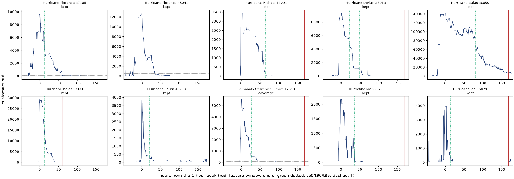

# Real-storm check: Checkpoint 2 results

These are local runs on public data, done on 2026-09-23 at code commit
`51b3dd4`.

- **The rules** are fixed in `RESTORATION-PROTOCOL.md`: frozen at commit
  `2020f07`, with §15 (a schema-read clarification) added at `51b3dd4`.
- **The held-out years (2022–2025)** ran once, from that commit, and gave counts
  only (§3).
- **Evidence class (b):** local runs on the public EAGLE-I and OpenFEMA files.
  No model has been fitted or checked yet; that is Phases 3–4.

## In plain English

- **What this does:** it turns DOE's county power-outage records (customers out
  in nearly every US county, every 15 minutes) into one clean restoration curve
  per county per tropical storm, with a written reason for every curve thrown out. It
  does the full job on the 2018–2021 storms, which the model will learn from.
  For the 2022–2025 storms, which the model will be tested on, it only counts
  how many curves survive. Nobody looks at those curves until the model is
  frozen.
- **What it found:**
  - **Training:** 640 usable county curves from 18 storms, 16 of which have
    at least 5.
  - **Held out:** 553 usable curves from 13 storms, but only **9 storms have at
    least 5**. That is one short of the pre-set bar of 10, as the protocol
    predicted from FEMA's county lists alone. So the headline will be the share
    of county-level looks the check flags, not a count of storms.
  - **The data changed format between the two periods.** The 2018–2021 files
    never record a zero ("nobody out"). The 2022–2025 files do, over a million
    times a year. The rule decided before the freeze handled it mechanically, but
    the change is the biggest risk to a fair test (see "Findings").
- **Why it matters:** this is the first time Proteus's check pipeline touches
  real outcomes; the check itself runs in Phase 4. Every choice was committed
  before the check read any held-out outage value. §3 discloses a 3 MB peek at
  the 2024 file, and §15 followed a header-only read. The code enforces the
  seal, so the results can't be quietly tuned: any change after this point is a
  dated deviation.

## Words used here

- **County-event:** one county's outage curve for one storm, from its peak for
  7 days, or until another outage or the county's next storm begins.
- **Drop:** a curve thrown out, always for a data reason, never for being slow.
  Every drop is logged with its reason.
- **Held-out (sealed):** the 2022–2025 storms. They stay unread until the model
  is fitted and frozen; only counts are allowed out before that.
- **Y:** held-out storms with at least 5 county-events.

## Counts per split

| Step                                       | Training (2018–21) | Held out (2022–25) |
| ------------------------------------------ | -----------------: | -----------------: |
| Declared storm–county pairs                |              2,068 |              1,419 |
| `seen` (2024 file head, §3)                |                  0 |                  4 |
| `no_mcc` (no customer count)               |                 23 |                 13 |
| `not_in_file`                              |                 13 |                  8 |
| `no_event` (never crossed 1% of customers) |                455 |                187 |
| `no_peak`                                  |                  0 |                  0 |
| `left_censored` (already out)              |                 30 |                 17 |
| `not_substantial` (< 1,000 or < 5%)        |                799 |                469 |
| `spike`                                    |    7 (0.9% of 748) |    8 (1.1% of 721) |
| `resurge`                                  |  83 (11.1% of 748) |  91 (12.6% of 721) |
| `coverage` (> 10% missing)                 |   18 (2.4% of 748) |   69 (9.6% of 721) |
| **Kept county-events**                     |            **640** |            **553** |
| Storms with ≥ 1 event                      |                 18 |                 13 |
| Storms with ≥ 5 events                     |                 16 |              **9** |

The percentages divide by the substantial events that reached the shape
filters: kept plus `spike`, `resurge` and `coverage`.

**Per storm (pairs → kept):**

- **Training:**
  - 2018–19: Lane 4 → 0; Florence 279 → 48; Olivia 4 → 0; Michael 217 → 118;
    Barry 41 → 23; Dorian 228 → 50; Imelda 7 → 5.
  - 2020: Cristobal 64 → 5; Douglas 4 → 0; Hanna 32 → 8; Isaias 153 → 68;
    Laura 225 → 70; Sally 169 → 35; Delta 93 → 55; Zeta 119 → 52; Eta 32 → 4.
  - 2021: Elsa 37 → 8; Fred 43 → 11; Henri 53 → 6; Ida 200 → 70;
    Nicholas 64 → 4.
- **Held out:**
  - 2022–23: Ian 213 → 74; Nicole 61 → 20; Hilary 5 → 1; Idalia 127 → 44;
    Lee 30 → 11.
  - 2024: Beryl 67 → 28; Debby 274 → 89; Ernesto 3 → 2; Francine 64 → 22;
    Potential Tropical Cyclone Eight 6 → 1; Helene 505 → 229; Milton 51 → 28.
  - 2025: Chantal 7 → 4; Halong 6 → 0.

## The pre-registered decision

**Y = 9, below 10.** So under §9 the headline is the county-event flag rate over
all held-out looks, with a storm-resampled interval. The model is rejected if
that interval lies entirely above 5%. X of 9 is still printed with its
Clopper–Pearson interval. At 0 of 9 flagged, the upper bound would be 33.6%.

§9 predicted this from FEMA's county lists alone. The nine storms with 5 or
more events are exactly the nine with 30 or more declared counties: Ian, Nicole,
Idalia, Lee, Beryl, Debby, Francine, Helene and Milton.

## Training curves

The 10 curves were drawn at random from the 748 substantial training events
before the shape filter (seed `restoration-protocol/checkpoint2-curves`):



- Nine are kept. The tenth is a `coverage` drop: Fred in Calhoun County, FL,
  where the feed has gaps after about 50 h.
- The Nassau County, NY (Isaias) panel shows a slow event kept, not dropped. It
  peaks at 140k customers out, and a week later it is still about 5% of its peak
  (roughly 2% of the county's customers).

**Training features across the 640 kept events** (hours from the one-hour peak):

| Milestone | 25th pct | Median | 75th pct | Not reached in 7 days |
| --------- | -------: | -----: | -------: | --------------------: |
| t50       |      4.0 |    9.6 |     29.1 |                    10 |
| t90       |     11.3 |   31.4 |     73.3 |                    34 |
| t95       |     13.5 |   36.6 |     83.8 |                    44 |

- **Flags on kept events:**
  - 98 are `over_mcc`: the peak exceeded the county's modelled customer count.
    These are kept.
  - 16 never ended.
  - 244 are `cut_early`: another outage started, or the county's next storm
    arrived, before 168 h.

## Findings

1. **The held-out files record zeros, and the training files don't.**
   - **What was seen.**
     - 2018–2021 contain 0 rows with `customers_out` = 0.
     - 2022, 2023, 2024 and 2025 contain 1.28M, 1.31M, 1.09M and 1.14M.
     - In 834, 947, 702 and 76 counties respectively, zeros make up at least 10%
       of the county's rows.
   - **What the rule does.** Under the pre-registered rule (§6), those counties'
     absent rows count as missing instead of zero.
   - **The likely effect.** The `coverage` drop rate is 9.6% held out against
     2.4% in training, and this is the likely cause. That is ASSUMED: the seal
     allows only counts, so it was not checked by county.
   - **Why it matters for Phase 4.** Gaps longer than 2 h are not bridged
     (§6), and they break the 2-hour hold a milestone needs. In zero-storing
     counties, real curves may therefore reach milestones later than they really
     did. The check would then score them as slower than the simulated worlds,
     which means false flags.
   - **What Phase 3 can do.** This is an addition, not part of the
     pre-registration. On training data only, it can compute a worst-case bound:
     treat the absent rows in training curves as missing and recompute the
     milestones. In 2018–21 an absent row is usually a real zero, so this
     overstates the effect. Nothing can be fixed on held-out data without a dated
     deviation.
   - The schema read could not see this, because it reads no values.
2. **Other format changes:**
   - The 2023 file calls the count column `sum` (§15).
   - The 2024 file adds `total_customers`.
   - The held-out files run to Dec 31 23:45, while 2018–2021 stop at Dec 31
     00:00. No window reaches Dec 31 (the latest data windows end on 6–7 Dec, for
     Nicole and Eta), so this has no effect here.
   - 2019 and 2025 hold 131 and 121 duplicate rows, which keep their maximum.
3. **The 2024 file is sorted by county, not by time.**
   - A 3 MB head read during research therefore held four Alabama counties' whole
     2024, Helene included.
   - Those four were dropped as `seen` at the run's first step, by a rule fixed
     before the run.
   - Checked from codes and timestamps only.
4. **Some Hawaii counties never appear in a file.** Hawaii, Kauai and Maui are
   missing from 2018, and Hawaii County from 2020. They make up 7 of the 13
   `not_in_file` training pairs. The other 6 are 51520 (Florence), 01033 and
   01049 (Sally), and 28081, 28117 and 28141 (Ida). Without the rule, they would
   have passed as "no outage".
5. **The spike S1 cross-check.** On 2020–21 this loader keeps 396 events from 13
   storms, 11 of them with ≥ 5. S1 had 326 / 13 / 11.
   - The two chains differ in several pre-registered ways (§14).
   - The largest known difference is that S1 dropped slow and over-count events,
     which this protocol keeps: 58 of the 396.
   - The rest is ASSUMED to come from the other differences. The two sets were
     not reconciled event by event.

## Deviations from the protocol

None.

- **§15** records a column name found by the pre-registered schema read, before
  any held-out value was read.
- **The training run before the freeze** is disclosed in §3. The training numbers
  above come from a rerun at `51b3dd4`, and they match §8's reference counts.
- **The raw held-out counts file** (git-ignored) also breaks the per-storm drop
  counts down by reason. This doc does not publish that breakdown. Under a
  strict reading of §3's "per-step drop counts", it goes slightly further than
  §3 allows. It holds counts only, with no curves or features.

## What this does not show

- **Nothing about the model yet.** No fit and no check have run.
- **Whether the zero-format change will bias the check.** Finding 1 names the
  risk. Phase 3 can bound it on training data, as a worst case.
- **Anything per county or per storm about held-out restoration speed.** No
  held-out curve or feature exists outside the sealed run.

## Reproduce

From `engine/`:

```bash
bash python/eaglei/fetch.sh                                   # download + MD5 check (about 9.7 GB)
.venv/bin/python -m pytest python/eaglei/ -q -p no:cacheprovider
.venv/bin/python -m python.eaglei.checkpoint2 train           # about 70 s, writes .cache/restoration-check/
.venv/bin/python -m python.eaglei.checkpoint2 held_out        # counts only; a rerun is a dated deviation (§3)
```

The FEMA snapshot was fetched once, by `python/eaglei/fetch_fema.sh`, and is not
re-fetched. Package versions: numpy 2.5.2, pandas 3.0.5, scipy 1.18.0 and
matplotlib 3.11.1.
